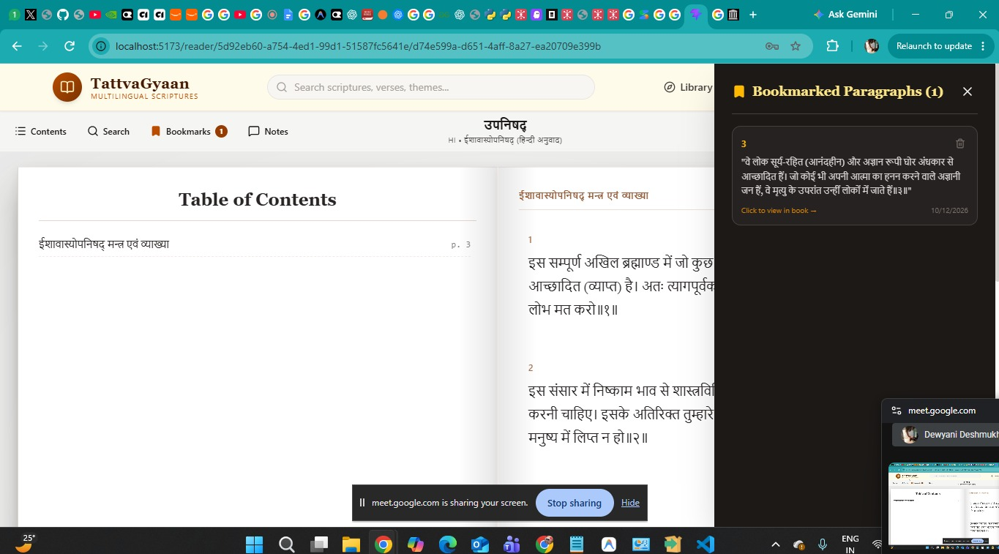
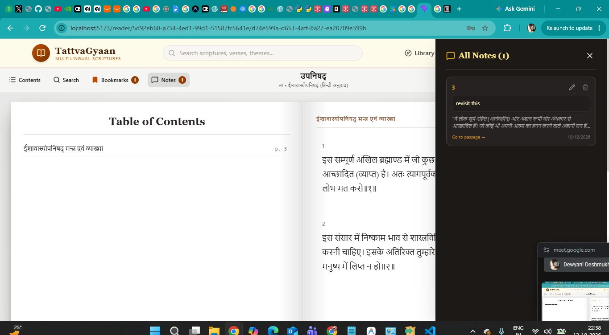

1) Add 3D flip effect in the book similar to what is implemented in this website - https://www.mahakavya.com/nirvan-upanishad-hindi/   

1) Add this in mahabharata - "C:\Users\HP\Downloads\ghmb101.pdf"
   Add this in upanishadas - "C:\Users\HP\Downloads\ईशादि_नो_उपनिषद-1.pdf"
   Add this in manusmriti - "C:\Users\HP\Downloads\मनुस्मृति-सम्पूर्ण.pdf"
   Add this in ramayana - "C:\Users\HP\Downloads\Valmiki Ramayana aur Ramakien Ek Tulnamatmak Adhyayan.pdf"

2) Implement bookmark section like this 
   

3) Implement notes section like this 
   
